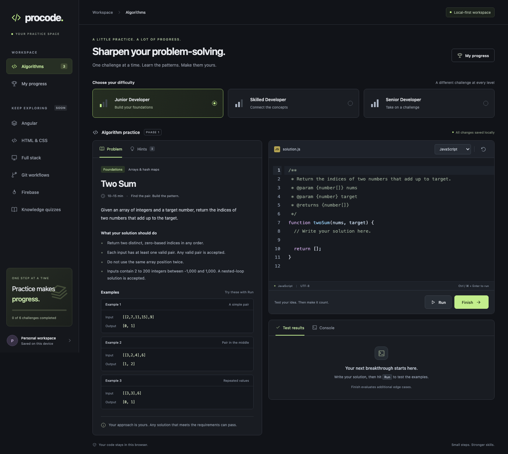
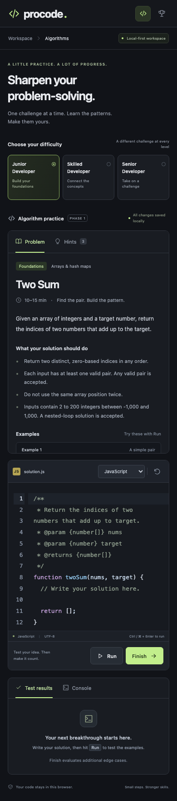
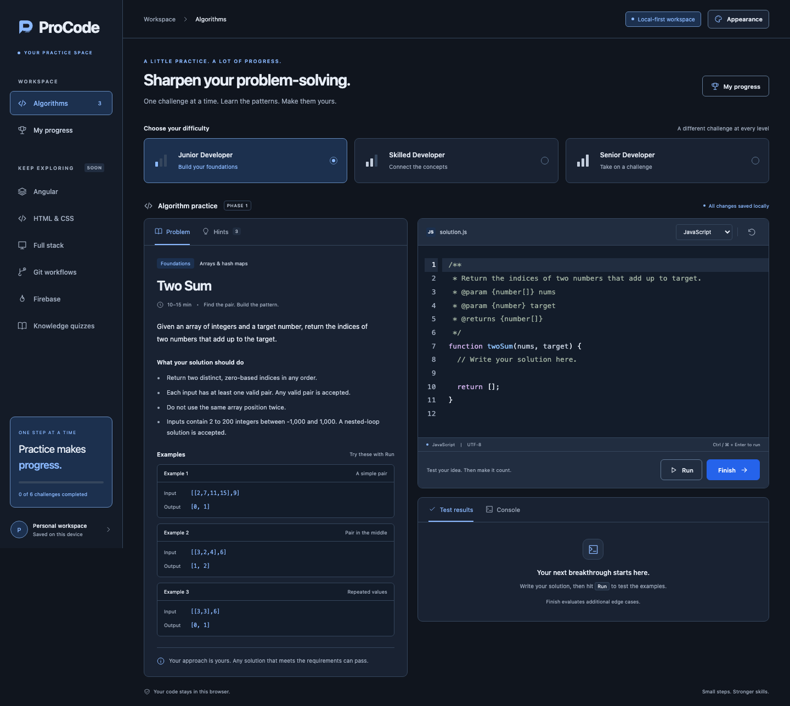
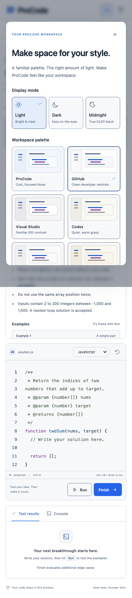

# Verification

## Manual output tabs and regression sweep, 0.2.2, 2026-10-14

- Removed the method-grading branch that selected Test results after execution. Run and Finish preserve the user's selected Console or Test results tab, including a selection made while grading runs. The new regression test fails against the prior build and passes against this build after waiting for actual execution to finish. Correct output, method warnings and completion requirements remain intact.
- All 122 distinct Chromium scenarios are verified across the focused run, regression sweep and targeted rechecks. The five focused scenarios cover both languages, both actions, both tabs, correct/different methods, and tab/focus changes during execution. The remaining 117-scenario run passed 114; three failures involved test input synchronization or fixture indentation, and pass after correction. Angular helpers now wait for the selected draft and exact saved replacement; the Dijkstra fixture's final brace matches editor indentation. A readiness assertion also accounts for CodeMirror virtualizing offscreen lines. No additional application regression was found.
- The sweep covers every practice section, all named method checks, wrong-algorithm rejection, Run versus Finish, errors/timeouts/cancellation, isolation, drafts/progress/migration, exports, quizzes, undo/Focus mode, all appearance combinations, responsive layouts and automated accessibility. All 188 unit tests, four router tests, six contacts API tests and two desktop asset tests pass. Strict application TypeScript, spec TypeScript, unused-symbol checks, changed-file formatting and the installed dependency tree checks pass.
- The production build passes at 859.92 kB initial raw JS/CSS, below the existing 860 kB warning budget. No dependency, grading-contract or storage-schema change. Added helper files remain below 300 lines, with named helper functions at 15 lines or fewer. Pre-existing oversized application files/functions remain outside this focused correction.
- All five packaged-app scenarios are verified across the initial run and targeted sorting recheck. The sorting test now awaits the completed accessible method announcement, since the browser-specific frame URL predicate did not observe Electron's completed frame removal. It checks manual tab selection, wrong-method feedback and correct selection sort in both languages, plus persisted completions after relaunch. The other scenarios cover bundled runtimes, previews, desktop isolation, downloads, workflows, quizzes and window layouts.
- Packaged `release/ProCode-0.2.2-arm64.dmg` (approximately 146 MiB). App signature verification, disk-image verification and the SHA-256 check pass. This remains the owner's self-contained Apple Silicon build with local ad-hoc signing. Packaging logs: `/tmp/procode-tabs-bundle.log` and `/tmp/procode-tabs-dmg.log`.
- Browser coverage is Chromium-only. Session logs: `/tmp/procode-tabs-unit.log`, `/tmp/procode-tabs-focused.log`, `/tmp/procode-tabs-regression.log`, `/tmp/procode-tabs-angular-recheck.log`, `/tmp/procode-tabs-angular-alternative.log`, `/tmp/procode-tabs-method-recheck.log`, `/tmp/procode-tabs-desktop.log`, and `/tmp/procode-tabs-desktop-recheck.log`.

## Output and method grading, 0.2.1, 2026-10-14

- Added independent output and method grades for selection/bubble/insertion/merge sort, linear/binary search, Dijkstra, prefix trees and breadth-first level traversal. Both languages keep correct output checks passed when method evidence differs or is unverified. Finish requires both grades. Existing version 1 drafts migrate verbatim; earlier output-only completions for these nine exercises require another Finish.
- All 188 unit tests pass. Verified 50 distinct Chromium scenarios across the regression run and focused rechecks: the initial 48-scenario run passed 45, with three catalog assertions corrected for the new grading/status behavior; the expanded focused suite covers 19 scenarios, including two new analyzer-loading failures. After helper extraction, one Python positive scenario hit an automation input race. The helpers now wait for the rendered CodeMirror draft and saved source. That scenario and the sequential sorting scenario pass their targeted rechecks; the other 18 focused scenarios passed before that wait-only correction. No application grading failure remains.
- Browser checks cover all nine required methods, all 24 cross-sort substitutions, alternative selection/bubble/insertion/search implementations, built-in shortcuts, unrecognized quicksort, linear search substituted for binary search, Bellman-Ford substituted for Dijkstra, whole-word storage substituted for a trie, and DFS substituted for BFS. Missing analyzers and method-analysis timeouts preserve normal output results and withhold credit. Existing exercise grading, console diagnostics, timeouts, persistence, output tabs and all Clean code exercises were included in regression coverage.
- Method feedback passes affected-layout checks at 390, 768 and 1440px with no document/feedback overflow. Wide and mobile screenshots were visually inspected. Automated accessibility checks pass for the feedback panel. JavaScript and Python syntax, strict TypeScript, unused-symbol checks and formatting pass.
- Split method policy, probe data, reference sorting variations, comparison sequences, graph relaxation and trie/traversal validation into focused modules. Extracted method execution from the shared executor and separated event capture from parsed-source instrumentation. New grading/instrumentation/test-helper source files are under 300 lines, and their functions meet the 15-line limit, verified with the installed TypeScript parser and Python `ast`. Pre-existing larger code, including `src/app/app.ts` (419 lines), `core/exercises.ts` (313 lines), and long component/shared-runner functions, remains outside this focused refactor.
- Production build passes at 859.96 kB initial raw JS/CSS, below the unchanged 860 kB warning budget. Method grading and analyzer assets load on demand. No dependency or infrastructure changes; the package version is 0.2.1. Remaining bundle headroom is small.
- `npm run package:mac` passes: production build, two asset tests, local app packaging/signing, five packaged-app scenarios, DMG creation and image verification. Packaged tests include wrong-method sorting in both languages followed by correct selection sort and persisted completions after relaunch. `codesign --verify --deep --strict`, `hdiutil verify` and the SHA-256 check pass. The updated artifact is `release/ProCode-0.2.1-arm64.dmg`, approximately 146 MiB. It remains a personal Apple Silicon build with ad-hoc signing and no Apple notarization.
- Method recognition is conservative and covers documented common implementations. Unusual legitimate variants may require additional evidence support and remain unverified. This does not certify complexity or provide tamper-proof assessment. Safari/Firefox were not tested. Session logs: `/tmp/procode-method-unit.log`, `/tmp/procode-method-regression.log`, `/tmp/procode-method-recheck.log`, `/tmp/procode-method-input-recheck.log`, `/tmp/procode-method-sort-recheck.log`, and `/tmp/procode-method-package.log`.

## Personal macOS DMG, 2026-10-09

- Created `release/ProCode-0.2.0-arm64.dmg` (approximately 146 MiB) and its SHA-256 file, containing an Apple Silicon ProCode.app, an Applications shortcut and installation notes. Electron 44.7.0, production web assets and all practice runtimes are bundled; no end-user Node.js, Python installation or localhost server is required.
- The complete `npm run package:mac` command passes: production build, two desktop-asset boundary/MIME tests, app packaging and ad-hoc signing, four packaged-app tests, image creation and image verification. The build remains 857.36 kB initial web JS/CSS. All 185 existing unit tests also pass; changed code passes formatting and syntax checks. The final packaging dependency install reported zero known vulnerabilities.
- Desktop tests cover JavaScript/Python grading, full relaunch persistence, Angular compilation and interactive preview, full-stack Angular/API workers, both Clean code analyzers, HTML previews, Git/Firebase workflows, a completed quiz, native JSON downloads, blocked network/file navigation, renderer isolation and window widths of 1440, 768 and 640px. Wide and compact screenshots were visually reviewed. Tests use temporary profiles and do not change the owner's saved work.
- Fixed a desktop-only runtime issue found during verification: Chromium throttled short timers in offscreen cross-origin grading frames. Disabled timer throttling in the wrapper while preserving execution deadlines, iframe sandboxes and renderer isolation. Desktop automation now waits for selected file tabs and updated quiz questions before entering data, and verifies full-stack saved files before grading. No web grading logic changed.
- `codesign --verify --deep --strict` passes for the packaged app and a copy extracted from the mounted DMG. `hdiutil verify` and the SHA-256 checksum both pass. Mounted the DMG read-only, copied ProCode.app into a temporary installation directory, and verified real JavaScript/Python execution and persistence through a full relaunch of that copy. The temporary mount, installation and profile were cleaned up.
- This is a locally ad-hoc signed build for the owner's Mac, not Developer ID signed or Apple-notarized. No signing identities were installed, and no infrastructure or publishing was configured. Desktop data is separate from browser data; automatic migration/import is not implemented. Tested on Apple Silicon macOS 27.0.1; the bundle inherits Electron's macOS 13 minimum, but other OS versions and Intel Macs were not tested.
- macOS 27 prints deprecation notices for the `hdiutil` commands, but creation, mounting and verification succeed. The scripts retain compatibility with earlier macOS tooling. Rebuild and installation details are in [DESKTOP.md](DESKTOP.md); the final build log is available for this session at `/tmp/procode-dmg-build.log`.

## Sanity check and export cleanup, 2026-10-09

- Consolidated eight JSON-download implementations in `src/app/core/download.ts`. Existing filenames, JSON formatting, saved-state payloads and the Clean code deferred export entry point are preserved. Blob URLs are still released after a one-second delay, including when download setup throws.
- All 185 unit tests, four router tests and six local contacts API tests pass. TypeScript checks with `--strict`, and separately with `--noUnusedLocals --noUnusedParameters`, pass without diagnostics. Changed TypeScript files pass Prettier.
- `npm ls --depth=0` reports a valid installed dependency tree. `npm audit --json` reports zero known vulnerabilities on this date.
- The full Chromium run passed 102 of 103 tests. The remaining failure was a stale section-persistence assertion expecting six junior data-structure options when the catalog now contains seven; its skilled list also omitted BST validation. Updated those assertions to compare complete lists with the current catalog. The corrected persistence scenario passed on a targeted rerun, so all 103 scenarios are verified across the full run and recheck. No application failure was found.
- Browser coverage includes real JavaScript/Python execution, all practice sections, local persistence/migration, exports, incorrect-answer rejection, errors/timeouts, isolation, quizzes, keyboard controls, Focus mode and all 21 appearance combinations. Responsive checks passed at 320, 390, 768, 1024 and 1440px. Fresh desktop and 320px screenshots for Algorithms and Clean code were visually inspected for wrapping, navigation, icons and overlap. Automated accessibility checks passed. User-facing source contains no em dashes or emoji.
- Browser verification is Chromium-only; Safari and Firefox were not tested. Full-run and recheck logs are available for this session at `/tmp/procode-sanity-browser.log` and `/tmp/procode-sanity-browser-recheck.log`.
- Production build passes without budget warnings: 857.36 kB initial raw JS/CSS, approximately 230.13 kB estimated transfer. The initial restricted build aborted without a diagnostic; the normal-permission baseline and post-cleanup builds both passed. The raw initial bundle decreased by approximately 0.84 kB, while estimated transfer increased by approximately 0.23 kB due to bundling/compression.
- Follow-up opportunity: the initial bundle is within approximately 2.64 kB of the 860 kB warning budget. Consider deferring more algorithm catalog data before adding substantial initial-load features.
- No dependency, storage-schema, infrastructure or account changes. This workspace has no Git repository; pre-edit source copies are available at `/tmp/procode-sanity-backup/src` for this session.

## Original Phase 1 verification

Verified on October 6, 2026, using Node.js 24.19.0 and Chromium on macOS.

## Automated results

- Production Angular build passed with no bundle-budget warnings. Initial JavaScript/CSS is approximately 670 kB before transfer compression. The approximately 15 MB local Python asset directory loads on demand.
- 7 unit tests passed: alternate valid answers, invalid result rejection, tied windows, repeated-character requirements, numeric return types, persistent drafts/completions, corrupted data, and duplicate/unknown completion cleanup.
- Full 13-test Chromium suite passed: every exercise in both languages, Run vs Finish, hardcoded wrong solutions, local persistence, syntax/runtime errors, console output, JavaScript/Python infinite loops and recovery, cancel, hints/reset, browser isolation/network restrictions, responsive layouts, keyboard controls, and automated accessibility.
- After final editor line-wrap and gutter-alignment adjustments, production build plus the 3 affected accessibility, responsive, and keyboard tests passed again. Unit tests also passed again.
- Axe checks found no WCAG 2.1 A/AA violations in the tested desktop workspace, progress dialog, and mobile workspace. This is automated coverage, not a claim of complete accessibility certification.
- Layouts tested at widths of 320, 390, 768, 1024, and 1440 pixels, with no document overflow.
- Source formatting check passed. User-facing source was checked for prohibited em dashes and emoji.
- npm install audit reported zero known dependency vulnerabilities at installation time.

## Visual checks

Desktop and mobile layouts were inspected for text wrapping, heading spacing, navigation density, icons, editor readability, and control placement. Editor syntax colors and line-number contrast were corrected based on accessibility findings. Code wraps within the editor on narrow screens.

## Remaining boundaries

- Verified primarily in Chromium. Firefox and Safari require their own compatibility pass before claiming support.
- No accounts, cloud deployment, cloud persistence, or paid integrations were configured.
- Additional test cases and saved grades are local and inspectable.
- Worker timeouts protect against ordinary infinite loops; browser workers do not provide a hard memory quota.
- The catalog now contains 40 exercises in two languages, with 24 junior, 8 skilled, and 8 senior exercises, split into Algorithms and Data structures. The knowledge bank has 200 questions across ten topics.

## Appearance update (0.2.0)

Verified October 6, 2026:

- Production build passed with no bundle-budget warnings (approximately 691 kB initial raw JavaScript/CSS).
- All 7 unit tests and all 21 Chromium browser tests passed.
- Every combination of six palettes and three modes passed automated WCAG A/AA color-contrast checks in both the appearance dialog and workspace.
- Verified true-black canvas/editor in all Midnight presets, saved preferences after reload, and preserved drafts and undo history across theme changes.
- Appearance dialog verified at 390 px and 320 px, including no horizontal overflow, keyboard dismissal, and focus return.
- Existing JavaScript/Python grading, cancellation, timeout recovery, and persistence tests still pass.
- Blue accents, the new ProCode logo/wordmark, editor syntax, and Light-mode surfaces were visually inspected. No code changes to grading were needed.
- Tests now use port 4300 independently of the live development app on port 4200.

## Interface copy cleanup, 2026-10-06

- Removed promotional headings, motivational messages, redundant descriptions, and repeated status explanations from the workspace and dialogs.
- Production build and all 21 existing browser tests passed, including JavaScript/Python practice flows, dialog interactions, persistence, and automated accessibility across all 18 appearance combinations.
- After the final browser-title and compact-card adjustments, rebuilt and repeated the responsive check at 320, 390, 768, 1024, and 1440 pixels.
- Visually inspected desktop and 320-pixel layouts for wrapping, spacing, and control visibility. Screenshots: `screenshots/streamlined-desktop.png` and `screenshots/streamlined-mobile.png`.
- The local development server responded successfully on port 4200.

## Source-based appearance presets, 2026-10-06

- Production build passed with a 702.23 kB initial bundle (193.52 kB estimated transfer).
- All 22 Chromium browser tests passed. Coverage includes all 18 appearance combinations, automated WCAG A/AA checks, real JavaScript and Python syntax colors, independent theme-preview tokens, preserved editor undo/drafts, and saved appearance preferences.
- The added syntax regression check caught a function-declaration fallback; explicit function-definition tags now use the correct function token. It waits for CodeMirror highlighting to settle after language changes.
- The theme generator checks text/syntax contrast and records each luminance adjustment in `theme-contrast-adjustments.json`. It runs locally without external dependencies or network requests.
- Visually inspected Cursor and Codex dark workspaces and the appearance picker at 320 pixels. Existing responsive tests passed at 320, 390, 768, 1024, and 1440 pixels. Source-theme screenshots are saved in `screenshots/source-*.png`.
- Local development server on port 4200 returned HTTP 200.

## Complete OLED palettes and Claude desktop, 2026-10-06

- Production build passed (702.47 kB initial bundle, 194.37 kB estimated transfer).
- All 11 targeted browser tests passed: accessible workspace/picker for all 18 theme-mode combinations, real JavaScript/Python syntax and preview tokens, persisted preferences and undo history, small-screen appearance controls, and responsive layout.
- New OLED coverage verifies that surfaces, hover states, borders, text, accent fills, selections, active lines, status backgrounds, and syntax differ from Dark in every preset. Rendered panels/controls stay below relative luminance 0.025, with primary controls below 0.1. These are visual design checks, not hardware power measurements.
- Visually reviewed the ProCode OLED workspace, Claude desktop Dark palette, and Claude OLED picker at 320 pixels. Screenshots are saved as `screenshots/oled-*.png` and `screenshots/theme-claude.png`.
- Claude theme values were read from installed Claude desktop 2.26454.0. Source hashes identify the CDS stylesheet and named Claude Light/Dark syntax definitions. No vendor code or bundled fonts were copied into the app.

## Junior catalog and editor assistance, 2026-10-06

- Expanded to 16 algorithms, including 14 junior exercises and 32 exercise/language combinations.
- Production build passed with no budget warnings: 779.48 kB initial JS/CSS, approximately 212.89 kB transferred.
- All 29 unit tests passed, covering existing semantic graders, new reference solutions, strict array/boolean/string outputs, old workspace migration, stale selections, and syntax-aware bracket nesting.
- All 30 browser checks passed across the final regression run and targeted retries. The final full run passed 28 checks; two browser sessions stalled and exceeded their timeouts. Both affected checks passed unchanged on retry (all new Python exercises and syntax colors across all themes).
- New exercises ran real JavaScript and Python solutions through Finish. Checks cover three examples plus additional boundary cases, including sorting duplicates/numeric order, empty inputs, all-negative subarrays, invalid nesting, and staircase base cases.
- Verified category filtering, independent drafts, saved algorithm selection, difficulty restoration, rejection of example-only sorting answers, and rejection of truthy non-booleans.
- Verified automatic pairing, closer skipping, selection wrapping, paired deletion, and undo in both languages. Nested pairs share colors at each depth, punctuation highlighting cannot override them, and the cursor highlights its matching pair.
- Existing isolation, cancellation, error handling, timeout recovery, all 18 appearance variants, keyboard controls, and automated WCAG checks remain passing.
- Responsive checks passed at 320, 390, 768, 1024, and 1440 pixels. Desktop and 320-pixel screenshots were visually inspected for selector spacing, text wrapping, and editor readability. Updated images: `screenshots/catalog-desktop.png`, `screenshots/catalog-mobile.png`, and `screenshots/editor-bracket-colors.png`.
- Changed source passes Prettier. No em dashes or emoji were added to UI copy. The local development server was restarted at `http://127.0.0.1:4200/`.

Named sorting techniques are taught through prompts and hints. Grading verifies output, not implementation technique or asymptotic complexity. Browser verification remains Chromium-based.

## Output tab behavior, 2026-10-07

- Console now opens by default on the left; Test results is on the right. Run and Finish retain the currently selected output tab, including a selection changed during execution.
- Production build passed. All 19 affected Chromium checks passed: output-tab regression, practice and catalog execution, workspace accessibility, responsive layout, and the appearance/draft regression.
- The output-tab regression verifies desktop/mobile ordering, defaults, console retention after Run/Finish, Test results retention, switching while a run is starting, and left/right arrow-key navigation.
- Updated existing execution tests to explicitly select Test results when asserting grading details. README and changelog describe the new behavior.

## Skilled/senior catalog and knowledge quizzes, 2026-10-07

- Added seven skilled and seven senior exercises, for 30 algorithms and 60 exercise/language combinations. All 14 additions passed real JavaScript and Python Finish execution, including alternate-valid Three Sum and course-order results.
- All 52 unit tests passed. Coverage includes independent algorithm references, invalid output rejection, all 200 question records, per-topic counts, shuffling permutations, balanced mixed quizzes, scoring, incomplete-submit prevention, persistence, and invalid stored-session recovery.
- All 38 Chromium browser checks passed across the new-feature runs (2 advanced-algorithm and 5 quiz checks) plus the 31-check existing regression run. Initial quiz-test timing failures were corrected by waiting for the current question indicator before acting; the quiz checks then passed.
- Verified 10-question mixed-correctness grading, 20-question perfect grading, stable answers and order after reload, history review, explanations and external references, all-topic selection, unfinished-quiz replacement cancellation, and working quiz sessions when browser storage is unavailable.
- Quiz questions passed automated WCAG A/AA checks in all 18 theme/mode combinations. Setup and result review also passed automated accessibility checks; keyboard answer selection and navigation were exercised.
- Quiz layouts were checked at widths of 320, 390, 768, and 1440 pixels, with no document overflow. Desktop, 320-pixel questions, and mobile result review were visually inspected. Screenshots are `screenshots/quizzes-desktop.png`, `screenshots/quizzes-mobile.png`, and `screenshots/quizzes-review-mobile.png`.
- Production build passed without budget warnings: 807.80 kB initial JS/CSS (approximately 222.87 kB transfer), plus a deferred quiz bundle of 93.63 kB (approximately 27.91 kB transfer). The question bank is not loaded until the quiz area is opened.
- Checked 185 distinct original reference URLs, found four missing glossary pages, and replaced them with working primary sources. Also improved the invariant reference. The final bank contains 184 distinct reference URLs. Framework/API material was checked against current official documentation; successful URL checks alone do not establish editorial correctness.
- Changed code passes Prettier. Question content checks reject em dashes and emoji. README, architecture, exercise guidance, quiz authoring guidance, and changelog are updated.
- The local site returned HTTP 200 at `http://127.0.0.1:4200/`. No production infrastructure, accounts, paid services, or cloud database were provisioned.

Quiz banks currently contain 20 questions per topic, so repeat sessions may reuse content. Data remains local to the browser origin, with separate quiz export and no import/sync. Question-bank revisions require editorial review and version handling. Browser verification remains Chromium-based.

## Console diagnostics and repeated execution, 2026-10-07

- Production build passed without budget warnings (808.94 kB initial raw JS/CSS, approximately 223.05 kB transfer).
- All 52 unit tests and 18 targeted Chromium browser tests passed. The four new Console regressions were also rerun successfully when capturing visual evidence.
- Verified JavaScript and Python syntax errors, runtime errors, printed output before exceptions, grouped duplicate errors, corrected-code recovery, and matching errors in Test results. Runtime exception locations resolve to editor line 3 in both languages.
- Verified repeated Run/Finish on unchanged code keeps prior output visible while loading, replaces logs rather than accumulating them, preserves the selected tab and focused tab, and keeps Run/Finish in place while disabled. A second click at the same coordinates cannot cancel the run by hitting Stop.
- Existing timeout, cancellation, cancelled-download/stale-attempt, grading, persistence, keyboard, isolation, and responsive tests passed. Error-state and workspace automated WCAG A/AA checks passed.
- Console errors wrap without document overflow at widths of 320, 390, 768, and 1440 pixels. Visually reviewed `screenshots/console-error-320.png` and `screenshots/console-error-1440.png` for readable error text, stack frames, tab spacing, and action placement.
- Confirmed the development workspace loads at `http://127.0.0.1:4200/` in the in-app browser.
- Verification is Chromium-based. JavaScript syntax errors do not always include a source location; available runtime stack frames and Python traceback locations are displayed. Logs remain buffered until the attempt returns, and a terminated worker cannot return its unfinished logs.

## Remove execution loading controls, 2026-10-07

- Removed the Stop button, visible loading text, spinner, and their reserved layout space. Existing output and the empty-console message stay stable during execution. Run and Finish remain disabled while busy; assistive technology receives the output region's busy state.
- Production build passed without warnings (807.50 kB initial raw JS/CSS). All 18 targeted Chromium browser tests passed, including repeated Run/Finish with no loading controls, tab/focus preservation, JavaScript/Python errors and timeouts, and responsive/accessibility checks.
- Verified refreshing an active infinite-loop worker terminates it, preserves the saved draft, and permits another run. Refreshing during executor loading leaves no stale attempt. Four-second execution and 45-second initialization deadlines remain enabled.
- Reviewed updated desktop and 320-pixel console screenshots. Formatting checks passed. README, architecture notes, and changelog reflect the revised controls.

## Junior patterns and Data structures navigation, 2026-10-07

- Added ten junior exercises, bringing the catalog to 40 exercises / 80 language challenges: 24 junior, 8 skilled, and 8 senior. Algorithms contains 31 exercises; Data structures contains 9 linked-list, tree, and stack exercises.
- All 65 unit tests passed, including independent expected-answer derivation for all ten additions, strict output validation, area counts, legacy selection migration, and separate section persistence. An initial type mismatch in the new test oracle registry was corrected before the passing run.
- All 48 Chromium browser checks passed across two complementary runs: 12 catalog/new-section checks and 36 existing feature regressions. Every catalog exercise passed real JavaScript and Python Finish execution, including all 20 new language challenges.
- Verified input mutation is required where documented, unique-prefix counts reject non-integers and Python booleans, returned arrays are rejected for node-return tasks, cyclic returned lists fail promptly, and allocating new compatible nodes is accepted. Cycle detection receives only the actual head; trees are constructed with the documented fields.
- Verified independent section selections, per-difficulty choices, preserved drafts, active-section restoration on reload, shared progress, unchanged node-free exercise contracts, console diagnostics, timeout/refresh recovery, editor behavior, quizzes, and all 18 appearance variants.
- New Data structures navigation and exercise content fit widths of 320, 390, 768, and 1440 pixels without document overflow. Desktop/mobile WCAG A/AA automated checks passed. Visually reviewed `screenshots/data-structures-1440.png` and `screenshots/data-structures-320.png` for wrapping, heading spacing, controls, icons, and navigation density.
- Production build passed without bundle warnings: 826.85 kB initial raw JS/CSS (approximately 227.64 kB transfer), plus the unchanged deferred quiz bundle. Changed source passes Prettier; content tests reject em dashes and emoji.
- README, architecture, exercise-authoring guidance, implementation plan, and changelog document section ownership and adapters. Browser coverage remains Chromium-based; complexity and auxiliary allocation are instructional, not automatically certified.

## PyCharm source-based appearance, 2026-10-07

- Added PyCharm as the seventh preset, for 21 theme/mode combinations. UI colors come from installed PyCharm 2026.2.3 (262.10968.92) Islands Light/Dark JSON definitions. Syntax, selection, cursor, and active-line colors come from Light / Islands Dark XML schemes and their bundled parent schemes. The installed editor preference was Islands Dark.
- Added a repeatable read-only importer, per-token mapping, and hashes for five bundled theme/scheme entries plus product metadata. Full Midnight OLED tokens are an explicitly authored ProCode adaptation. Normal builds need neither the installed IDE nor network access.
- Production build passed without budget warnings (830.33 kB initial raw JS/CSS, approximately 227.96 kB transfer). All 17 appearance/quiz browser checks passed; after correcting dark comment-style inheritance, rebuilt and reran the four affected appearance checks successfully.
- Verified all 21 variants with automated WCAG A/AA audits, actual JavaScript/Python syntax colors, matching swatches, independent OLED surfaces, and saved preference restoration. PyCharm survives reload in all three modes without changing the editor draft. A 320-pixel picker layout has no document overflow.
- Reviewed Light, Dark, Midnight OLED, and mobile screenshots in `screenshots/pycharm-*.png`. Source formatting checks passed. README, theme provenance, source notices, and changelog are updated.
- These are source-based color mappings to ProCode's layout, not full IDE replicas. Contrast adjustments are recorded separately, and CodeMirror does not provide JetBrains' complete semantic-highlighting model. Verification remains Chromium-based.

## Returned-result grading correction, 2026-10-07

- Audited all 40 exercise contracts and both runtimes. Move Zeroes and Remove Duplicates were the only tasks requiring input mutation. Both now grade a complete returned array/list, with updated prompts, starters, hints, examples, and explanations. Removed the mutation-only and count/prefix adapters. Sorting already accepts either allocation strategy; list tasks accept copied or reused nodes; Number of Islands permits optional mutation and grades the count. Semantic comparators still accept valid alternative indices, tied windows, triplet orderings, and course orders.
- The exact reported JavaScript solution, including its console call, passes Run (3/3) and Finish (12/12). An isolated browser session confirms its v1 saved draft migrates unchanged to v2 and survives reload. Unit checks cover both changed exercises and languages, current-draft precedence, completion deduplication, and repeat loads.
- Production build passed (830.36 kB initial raw, approximately 227.95 kB transfer); all 69 unit tests passed. The 31 relevant Chromium checks passed across the initial run and targeted rerun: 29 passed initially, and two new tests needed their text selector scoped to the visible panel rather than its screen-reader announcement. All three new regression tests passed after that test-only correction.
- Browser checks executed reference solutions for every exercise in JavaScript and Python, accepted newly allocated arrays and modified returned arrays, rejected missing/incorrect returns and count-only answers, checked diagnostics and repeat-run tab stability, persistence, timeouts, isolation, and responsive accessibility. Formatting passed. Local port 4200 responds and serves the updated executor.
- Source and existing earned credit are preserved. Older solutions that only mutate an array or return a duplicate count must now return the requested array when rerun. Grading remains finite behavioral testing, not proof of all possible inputs or complexity; browser verification is Chromium-based.

## HTML and CSS practice, 2026-10-08

- Added 12 working exercises, with six HTML and six CSS exercises spanning all three difficulty levels. Reference browser checks confirm every starter fails Finish and every intended solution passes. Alternative label associations and a Flexbox solution pass; hidden/disabled form controls and desktop-only layouts fail with targeted feedback.
- Verified live updates, mobile/desktop preview sizing, Run/Finish tab retention, native preview isolation, remote resource blocking, HTML/CSS draft persistence, completion retention across reset, selection restoration, JSON export, and integrated 92-challenge progress. External CSS request attempts appear in browser instrumentation but fail with CSP before transferring resources; tests assert this rather than mistaking a blocked attempt for a successful request.
- All 74 unit tests pass. All 29 relevant Chromium checks pass across the regression and final targeted runs: 24 existing editor/algorithm/console/quiz checks, plus five new web-practice scenarios. The final targeted run passes all five after correcting waits for completed grading and accounting for CSP-blocked request events. Tests now own port 4317 and refuse to reuse an occupied port, after discovering an unrelated app on the old port 4300; that app was left running.
- WCAG A/AA automated checks passed in Light, Dark, and Midnight OLED at 1440, 390, and 320px widths. Escape and output-tab arrow keys work, and no document overflow occurs. Desktop and mobile screenshots reviewed in `screenshots/html-css-*.png`. Preview documents remain independently styled, with horizontal scrolling confined to their viewport panel.
- Final production build passes without budget warnings: 849.17 kB initial raw JS/CSS, approximately 234.19 kB transfer. The web-practice component/catalog is a deferred 48.20 kB chunk; HTML/CSS language extensions also load on demand. Formatting checks pass.
- These are finite semantic/layout checks in Chromium, not complete HTML syntax validation, screenshot matching, universal accessibility certification, or adversarial assessment. Browser error recovery still applies. Preview scripts, remote resources, submissions, embedded documents, and HTML style elements are intentionally disabled. Combined HTML/CSS/JavaScript projects remain a future practice area.

## Angular coding practice, 2026-10-08

- Added nine exercises, three per difficulty, with 59 behavior scenarios in total. Real Angular execution rejects all nine starters and accepts every reference solution. A plain-field counter also passes, demonstrating grading does not require the reference signal implementation.
- All 77 unit tests passed, including catalog contracts, independent storage validation, empty drafts, deduplication, invalid records, and unavailable-storage recovery. All 38 relevant Chromium browser checks passed across the regression and final targeted runs: 31 existing practice/editor/console/output/quiz/web/accessibility checks and seven Angular checks. One existing roadmap test still referenced Angular as coming soon; after updating it to Git workflows, the final eight-test run passed.
- Verified Angular forms, parent/child events, service sharing, stale asynchronous response handling, error recovery, pagination bounds, and related-field validation. Verified Run does not award credit, Finish records completion, interactive preview clicks update Angular, repeated runs retain selected tabs and prior output, and logs do not accumulate across attempts.
- Verified TypeScript syntax, Angular template parsing, constructor errors, loop limits, unsupported imports, printed output before exceptions, late preview event errors, and corrected-code recovery. TypeScript compilation runs in a disposable worker. The iframe cannot read app storage/parent DOM or use network requests; leaving Angular removes the preview. Native Angular form submissions work inside the sandbox while navigation/outbound form actions remain blocked.
- Verified draft/selection restoration after reload, scoped reset confirmation, earned-completion retention, JSON export, and combined 101-challenge progress. All old storage records remain separate.
- WCAG A/AA automated checks passed in Light, Dark, and Midnight OLED at 1440, 390, and 320px widths. Keyboard Escape and output-tab arrow keys work. Mobile navigation uses a separate row to avoid six-icon overflow. Screenshots reviewed in `screenshots/angular-desktop.png` and `screenshots/angular-mobile.png`; preview content is checked after viewport changes.
- Final production build passes without budget warnings: 807.03 kB initial raw JS/CSS (approximately 221.19 kB transfer). The deferred Angular component/catalog is 49.28 kB; the separately served Angular runtime and TypeScript compiler load only on Run/Finish. Python editor syntax now loads on demand. Changed source passes Prettier.
- Confirmed the live app at http://127.0.0.1:4200/ shows the Angular tab and its exercises, and serves Angular runtime version 22.2.1. Browser tests use their dedicated port 4317; the unrelated app on 4300 was untouched.

Limits: inline single-file exercises, supported imports only, no full TypeScript semantic/AOT template checking, and runtime stack positions may refer to emitted code. Ordinary loop guards are not hard CPU/memory isolation for deliberately hostile code. Scenarios remain inspectable and finite. Browser verification remains Chromium-based. No backend, paid service, infrastructure, or credentials were added.

## Angular interview collection expansion, 2026-10-08

- Added nine exercises, three per level, bringing Angular to 18 exercises with six per difficulty and 116 behavior scenarios. Topics: conditional rendering, configurable pipes, task identity, changing inputs, content projection, dynamic FormArray, OnPush updates, ControlValueAccessor, and component subscription cleanup.
- All 77 unit tests passed. Catalog checks validate metadata alignment, stable versioned IDs, per-level counts, scenario names/contracts, hints, and content rules. Original exercise IDs/versions and storage schema remain unchanged.
- All 35 relevant Chromium tests passed in two runs: seven Angular runtime/catalog tests and 28 interview/progress/existing-practice regressions. Every one of the 18 starters fails Finish and every reference solution passes all checks. Targeted mutations fail for exact pipe boundaries, whitespace validation, programmatic touch-state errors, and a listener that stops after one event. Alternative input getter derivation and explicit ngOnDestroy unsubscription both pass.
- Verified new and original Angular drafts/completions coexist, a new selection survives reload, and progress totals 110 challenges. Existing algorithm/data-structure solutions in JavaScript/Python, all twelve HTML/CSS solutions, persistence, errors, execution recovery, keyboard controls, and responsive/accessibility checks pass.
- Angular WCAG A/AA checks pass at 1440, 390, and 320px in Light, Dark, and Midnight OLED. Live local site shows the expanded exercise options without replacing the existing draft. Source formatting passes Prettier.
- Production build passes without budget warnings (approximately 807.81 kB initial raw JS/CSS, 221.17 kB estimated transfer). Exercise content remains in the deferred Angular chunk, approximately 75.15 kB raw. Runtime/import capabilities and local-only isolation are unchanged. README, architecture, authoring references, implementation plan, and changelog reflect the expansion.

Difficulty labels describe progression, not employer-specific interview frequency. Framework documentation supports the mechanics taught; checks evaluate finite observable behavior rather than proving exact implementation technique. Existing single-file/runtime/type-checking limitations remain. No additional services, packages, credentials, or infrastructure are required.

## Angular CRUD practice, 2026-10-08

- Added three complete contact CRUD exercises: Junior local state (10 scenarios), Skilled asynchronous service integration (15), and Senior conflicts/optimistic rollback (20). Angular now contains 21 exercises, seven per difficulty, with 161 scenario executions across the catalog. Combined completion progress totals 113 challenges. Original exercise IDs, versions, drafts, and completions are unchanged.
- All 77 Angular/unit tests and six independent Node API tests pass. Service tests cover stable IDs and revisions, create/read/update/delete persistence within a service instance, invalid/failed write atomicity, one-shot operation failures, stale update/delete conflicts, cloned responses, independent sessions, cold Observables, cancellation, and missing records. `npm run test:crud-api` is the repeatable API check.
- All 38 relevant Chromium browser checks pass across the catalog, regression, and final targeted runs. Every one of the 21 starters fails Finish and every reference solution passes all scenarios. Deliberately view-only creates fail reload checks; writes without revision checks fail conflict tests; optimistic deletes without rollback fail recovery checks. Existing interview, algorithm, data-structure, HTML/CSS, progress, storage, error, and execution-isolation checks remain passing.
- The manual preview workflow creates, edits, reloads, and deletes a contact. Reloading ProCode preserves the solution and selection, and rerunning successfully grades it while resetting sample records. An initial persistence test inspected an offscreen CodeMirror line and failed because the editor virtualizes long documents; the corrected test checks the saved source and successfully executes it after reload. Both final targeted CRUD checks pass.
- CRUD instructions/controls pass automated WCAG A/AA checks at widths 1440, 390, and 320px with no outer document overflow. Desktop and mobile screenshots reviewed in `screenshots/angular-crud-desktop.png` and `screenshots/angular-crud-mobile.png`. Live port 4200 exposes the new Contact Manager option.
- Final production build and changed-source Prettier checks pass without budget warnings. Initial JS/CSS is 808.08 kB raw (approximately 221.30 kB transfer); the deferred Angular exercise component/catalog is 89.17 kB raw. The prepared local runtime includes the new API. No dependencies, accounts, infrastructure, or credentials were added.

The API is a local Observable simulation, not HttpClient, an HTTP endpoint, Firebase, or a durable contact database. Sample records persist only across list reloads within a preview; each check/Run/Finish/new preview starts isolated data. Learner source and earned progress still persist normally. Existing single-file, finite-grading, Chromium-only verification, and type-checking/runtime-isolation limitations remain.

## Firebase command practice, 2026-10-08

- Added nine workflows, three per difficulty. Every reference workflow passes and every starter/empty attempt fails. Combined challenge progress is 122; existing IDs, versions and earned progress remain intact.
- All 112 unit tests pass, including 35 new Firebase tests. Coverage includes equivalent flag/alias forms, narrow and broad releases, wrong destinations, release history, target prerequisites, lifecycle/data flags, first-error behavior, unsupported scripts, malformed input, shell operators, bounds, fresh state, and saved-work validation/storage failure.
- Verified 28 distinct Chromium browser tests across Firebase, Angular, HTML/CSS, algorithms and accessibility. Four initial failures were obsolete 113-total expectations; tests now derive totals from catalog metadata, and all four passed on rerun. The rerun also rechecked all three Firebase browser tests. The catalog browser checks exercise all 9 Firebase workflows, all 21 Angular exercises and all 12 web exercises.
- Firebase browser checks cover Run versus Finish, errors after otherwise successful commands, stable output tabs/repeated attempts, keyboard shortcuts/tab navigation, virtual state, reset confirmation, empty-draft reload, export, navigation restore and combined progress. Automated WCAG 2.1 AA checks and overflow checks pass at 1440px, 768px and 320px; desktop and mobile screenshots were inspected for readable text, controls and navigation.
- Production build and changed-source Prettier checks pass. Initial bundle is 813.04 kB raw (222.07 kB estimated transfer); deferred Firebase UI/catalog/interpreter is 37.48 kB raw (10.28 kB transfer). No dependencies, external accounts, project configuration, or credentials were added. The existing localhost:4200 server serves the Firebase navigation.

The Firebase CLI/Emulator Suite is simulated, including login, initialization prompts/files, test-script success, imports/exports and deployment records. Verification does not certify real Firebase integration or rule security. Only the documented command subset is supported; SDK CRUD, rule editing/authorization testing, real scripts and cloud requests are outside this feature. Browser checks used Chromium, not Safari or Firefox.

## Full-stack projects, 2026-10-08

- Delivered six projects, two per level, with four editable files and 51 scenarios across client interaction, direct API calls, data state and responsive layout. Every incomplete starter fails, and every reference implementation passes all scenarios. Combined progress totals 128 challenges.
- All 122 unit tests pass, including ten new catalog/API/state tests. Reference handlers satisfy direct API cases with isolated initial data. Complete four-file drafts, empty files, validated selections/completions, malformed file sets, storage errors and exportable in-memory work are covered.
- Final browser run: 11 Chromium tests pass. Five cover full-stack projects, incorrect implementations, preview failure injection, stable tabs, four-file persistence, project reset/export, navigation disposal, syntax diagnostics, API loop recovery, blocked storage/parent/network access, alternate valid implementations, and accessibility/responsiveness. Six regressions cover shared Angular compilation/runtime errors, all Firebase workflows and persistence, global accessibility, and JavaScript/Python completion totals.
- Negative full-stack submissions demonstrate rejection of cosmetic saves, missing server validation, stale overwrites and duplicate retry operations. Additional scenarios cover literal text rendering, unknown routes, distinct IDs, rapid submissions, reserved request-key names, stock exhaustion, non-atomic rejections and lost successful responses.
- Initial browser failures were test-harness expectations: comparing the pre-fill fixture text rather than the actual CodeMirror draft, and an ambiguous tabpanel locator after adding file tabs. Tests now compare saved source before/after reload and scope output assertions to Console. Both pass on rerun.
- Automated WCAG 2.1 AA and horizontal-overflow checks pass at 1440px, 768px and 320px. Desktop/mobile screenshots were inspected for readable headings, file tabs, wrapped editor content, controls and eight-item navigation. Exercise layout scenarios run at 360px.
- Production build and changed-source Prettier checks pass. Initial JS/CSS is 817.67 kB raw (approximately 222.64 kB transfer); the deferred full-stack component/catalog/runner is 51.15 kB raw (13.39 kB transfer). Runtime assets remain local. The live localhost:4200 app visibly includes Full stack navigation. No dependencies, accounts, infrastructure or environment variables were added.

Limitations: the learner's JavaScript executes, but request transport and database are local browser-worker facilities, not HTTP/Express/Firebase or a durable database. Requests are serialized. Checks do not certify production security, database isolation, authentication, arbitrary correctness or malicious-code resource safety. Practice data resets between scenarios/attempts/previews; source and earned completion persist. Verification used Chromium, not Safari or Firefox.

## Git workflow exercises, 2026-10-08

- Delivered nine workflows, three per level, covering GitHub, Azure Repos and Bitbucket. Every reference passes and every incomplete starter fails. Combined progress totals 137 challenges.
- All 145 unit tests pass across 11 files. Git checks include equivalent command sequences, staging exclusions, published history, fetch/tracking separation, conflict resolution/abort, rebase ancestry, cherry-pick scope, revert preservation, stash restoration, reset modes, reflog recovery, reachable log output, non-fast-forward/lease rejection, PR validation, parser limits, atomic failure, repeat-run isolation and saved work.
- Final Chromium run: nine tests pass, including three Git tests covering all nine workflows, incomplete starters, Run versus Finish, PR field validation, console errors, stable output tabs, keyboard navigation, saved command/review fields, empty drafts, reset/export, section restoration and combined progress. Regressions cover all Firebase workflows, full-stack accessibility, JavaScript/Python completions, reset/hints/dialogs and responsive app navigation.
- Git UI verified at 1440px, 768px and 320px, including open command reference, populated test results and repository state. All navigation controls remain distinct with no document overflow. Axe WCAG 2.1 AA checks pass in the tested states. Expanded scrollable code/state regions are keyboard focusable. Desktop and mobile screenshots were visually inspected.
- Production build and changed-source Prettier checks pass. Initial JS/CSS is 822.37 kB raw (approximately 223.21 kB transfer); deferred Git component/catalog/interpreter is 51.93 kB raw (14.59 kB transfer). The existing localhost:4200 server responds HTTP 200. No dependencies, services, credentials or environment variables were added.
- Limits: this is a bounded local Git state model with simplified output and whole-file merges. It never runs real Git, changes real repositories or sends hosted pull requests. Only documented commands/options are supported; rebase/cherry-pick/stash conflict continuation and hosted review policies are outside the model. Tests verify this supported model in Chromium, not complete compatibility with Git or every browser.

## App-wide sanity check and coverage review, 2026-10-08

- Reviewed every practice section and difficulty. Added prefix-tree operations (skilled), LRU cache operations (senior), and streaming medians (senior), with original prompts, three public examples, additional edge cases, three hints and JavaScript/Python starters. Catalog totals: 100 distinct exercises, 143 language-specific completion challenges, and 200 quiz questions. See PRACTICE_COVERAGE.md for the complete distribution and learning boundaries.
- Added “Practice makes pro” beneath the desktop brand and beside the mobile brand. The tablet icon rail stays compact. Desktop and 320px screenshots were visually inspected; all 21 theme combinations pass their existing readability/accessibility and persistence checks.
- Unit verification: all 150 tests pass across 12 files. The six local CRUD API tests also pass. New structure references agree with independent simple models on deterministic 200-operation inputs; checks cover recency, repeated insertion, exact versus prefix membership, zero values, negative/fractional medians and strict output types. Browser checks accept a different valid sorted-array median implementation and reject a FIFO cache.
- All 86 distinct Chromium browser cases passed across the full baseline run and subsequent targeted runs. The initial 82-case run passed 80 cases; the two failures were obsolete progress expectations (113 versus the then-current 137), after all advanced solutions had already passed. Both now use the shared catalog total and pass. After expansion, a fixed two-item skilled menu assertion was updated to include the new prefix-tree exercise. New browser checks validate the three exercises in both languages, saved drafts/selections, completion totals and expanded keyboard-accessible references.
- The full run exercised every existing reference solution, all Angular and full-stack starters, invalid submissions, both algorithm languages, quiz sizes/topic selection/shuffling/review, storage warnings, draft persistence, reset/export, theme switching, editor pairs, console diagnostics, infinite-loop recovery, sandbox boundaries, responsive layouts and accessibility. Subsequent runs verified the affected catalog, navigation, console and keyboard behavior against the updated production bundle.
- Fixed keyboard access to overflowing reference/state/diagnostic blocks in Firebase, Full stack, Angular and HTML/CSS, plus the algorithm console and execution-error output. The expanded-reference test covers desktop/mobile app panels, scopes editing and Run to the active code workspace after section switches, and verifies that End scrolls a populated algorithm console. Learner HTML preview accessibility is separate from the app-panel audit; its sandbox remains unchanged.
- Production build and changed-source Prettier checks pass. Initial JS/CSS is 832.34 kB raw (approximately 225.68 kB transfer), below the existing 850 kB warning budget. The local development site returns HTTP 200 on port 4200. No dependencies, credentials, cloud services or environment variables changed.
- Remaining scope limits: browser automation targets Chromium, not Safari/Firefox. Git/Firebase commands and backend data remain local simulations. Complexity is explained rather than enforced. Export is supported; import/cloud sync are not. This review verifies the exercised flows and provides a substantial initial curriculum, not exhaustive browser compatibility or interview certification.

## Developer workbench refinement, 2026-10-08

- Applied the redesign-existing-projects and Impeccable design skills to the existing app. Preserved the branching P, concise content, slogan, source palette tokens and local-first architecture. Added a shared workbench stylesheet, compact difficulty controls, connected instruction/editor/output panes, refined navigation and responsive quiz surfaces. DESIGN.md records the interface conventions.
- Added session-only Focus mode across all seven practice areas. Browser tests verify that the original editor node stays connected, drafts and undo history survive, output selection stays unchanged, instructions return, and quizzes remain unaffected. Keyboard activation and reduced-motion behavior are covered.
- All 150 unit tests pass. Final Chromium confirmation: all 44 selected browser tests pass. Coverage includes all 21 theme combinations, OLED luminance, syntax tokens, accessible dialogs, editor pairs, console diagnostics, repeated execution, output selection, Angular preview/errors, HTML/CSS preview, full-stack files/preview failures, Git/Firebase controls, quiz completion/review/persistence, reset/export and expanded keyboard-scrollable references.
- The first browser pass exposed transient low-contrast colors during palette interpolation. Removed color transitions so theme changes are immediate. The final theme and quiz accessibility checks pass. Shared styles also now take precedence consistently over Angular's scoped component styles.
- Automated WCAG 2.1 AA checks pass in the exercised states. Responsive tests cover 1440, 1024, 768, 390 and 320px without document horizontal overflow. Batched visual review covered desktop/mobile algorithms, Angular, full-stack, Git, quizzes and alternate palettes, followed by one confirmation round. The Impeccable mechanical detector returned no findings.
- Production build passes with 848.57 kB initial JS/CSS (approximately 228.11 kB transfer), below the existing 850 kB warning budget. Changed-source formatting checks pass. The live in-app browser at localhost:4200 exposes the new Focus control while preserving the current Angular draft. No packages, accounts, credentials, infrastructure or environment variables were added.
- Limits: browser automation uses Chromium; Safari and Firefox were not separately tested. Focus is a session layout preference and resets on reload. Existing learning/runtime boundaries are unchanged. The initial bundle is close to its warning budget, so future features should continue using deferred loading.

## Full-stack framework scaffolding, 2026-10-08

- All six full-stack projects now supply an Angular standalone component in app.ts, forms/common imports, template wiring, dependency injection, application startup and a local PracticeApi service. API starters register the documented endpoints through a self-contained route helper with method/path dispatch, decoded string parameters, URLSearchParams query and unmatched-route 404s. Every domain handler remains at 501 Not implemented. Bindings, UI behavior, validation, CRUD and advanced correctness remain learner responsibilities.
- API/client isolation and all existing grading goals are unchanged. Angular errors and rejected imports reach Console. Legacy mount(api) clients remain supported. Saved app.js projects normalize to app.ts without rewriting source; completions remain valid, export uses the normalized files and reset adopts the Angular starter.
- All 151 unit tests pass, including a source-preserving migration regression. Four Node router tests pass, covering dispatch, decoded parameters/query/body, untouched data, missing routes, malformed paths, handler errors, parameter isolation and worker serialization.
- All 11 targeted Chromium browser tests pass: every real Angular/router reference solution, every incomplete starter, all legacy client/API references, missing event bindings, 501 handlers, template/import errors, error recovery, isolation, migration/reset, cosmetic-save and client-only-validation rejection, stale writes, duplicate retries, preview failures, tab persistence, export, alternate implementations and shared Angular compiler/runtime behavior. The expanded-reference accessibility regression also passes (12 browser tests total).
- Initial verification stopped at a new test's overly exact Test results selector after the result count appeared. Corrected the selector and a missing list hook in the new reference fixture; the final run passes. These were test-fixture issues, not a production execution stall.
- Desktop and 320px screenshots were inspected; automated accessibility and overflow checks pass at 1440, 768 and 320px. Source formatting and the production build pass. Initial bundle: 848.67 kB raw (about 228.01 kB transfer). The separate locally served full-stack runtime is approximately 1.25 MB raw and loads on execution. Its served SHA-256 on localhost:4200 matches the generated asset. No dependency installation, external runtime requests, credentials or infrastructure changes were needed.
- Limits: API routing is a documented ProCode helper, not Express or a Firebase SDK. Data and transport remain local/in-memory. TypeScript is transpiled with syntax diagnostics rather than full project type checking. Browser verification uses Chromium; existing finite-grading and personal-lab sandbox limitations still apply.

## Clean code practice (2026-10-08)

- Added six refactoring exercises, two per difficulty, in both JavaScript and Python. Verified all twelve sloppy starters pass their behavior examples/additional cases while failing cleanup, and all twelve independent reference implementations pass Finish.
- All 163 unit tests pass across 13 files. New coverage includes catalog contracts, alternate JavaScript implementations, deep input mutation, parsed-source rules, comments/string decoys, unused-helper rejection, strict value comparison, syntax errors, saved selections/drafts/completions, corrupted storage and storage-write failures.
- All 23 selected Chromium tests pass across Clean code, algorithm practice, Console diagnostics, output-tab behavior and accessibility. After final progress/export optimization, the five Clean code browser tests passed again. These verify incorrect behavior rejection, shallow-copy mutation, Python/JavaScript errors, loop timeout and recovery, navigation cancellation, Run vs Finish, persistent empty drafts, language switching, reset confirmation, JSON export and Focus mode.
- Responsive navigation and expanded failed-check feedback pass automated WCAG 2.1 A/AA checks at 1440, 768 and 320 pixels. All ten navigation actions remain visible with no document overflow. Desktop/tablet/mobile screenshots were visually inspected for wrapping, SVG icons, code legibility and button placement. No em dashes or emoji were found in the new user-facing source.
- Production build passes without bundle-budget warnings (approximately 850 kB initial raw JavaScript/CSS, 228 kB estimated transfer). The new workspace and source analysis load on demand. Source formatting passes. Runtime assets are generated locally during install/start/build. The local development site was restarted on 127.0.0.1:4200 and its analyzer asset responds successfully.
- Structural checks enforce the prompt's listed constraints, not comprehensive readability or design quality. Browser verification targets Chromium; Safari and Firefox remain unverified. No cloud service, account, paid integration or new package was introduced.

## Targeted exercise expansion (2026-10-08)

- Added fifteen exercises across Data structures, Clean code, HTML, CSS and Full stack, with one addition per difficulty in each section. Coverage is now 121 distinct exercises and 176 completion challenges. All prior exercise keys and storage schemas are retained.
- All 175 unit tests pass across 14 files. New coverage checks independent JavaScript references, incomplete starters, wrong result types, a 200-operation stack history, 200-value multiway merging, an alternate flatten-and-sort solution, global BST violations, all added refactoring starters/references and direct API contract scenarios.
- All 23 selected Chromium tests pass. They include all nine Clean code exercises in both languages, all eighteen HTML/CSS exercises, all nine full-stack starters and solutions, real Angular clients/router scaffolds, and all three added data structures in JavaScript and Python. They also cover persistence, reset/export, output-tab stability, failures/recovery, isolation, keyboard access and responsive accessibility.
- After final grading refinements, all six HTML/CSS browser tests passed again, including rejection of shared field-error messages and transparent borders.
- Incorrect-answer coverage rejects shallow data copies, mutation, bad validation boundaries, broken error-summary links, static table headers, missing mobile layout, unfiltered API search, prefix-only page parsing and partial bulk writes. Existing full-stack wrong-answer and framework compatibility checks still pass.
- Desktop and 320px screenshots of the added CSS workspace were visually reviewed for safe wrapping, navigation density, SVG icons, editor readability, test-result layout and button placement. Section accessibility checks also cover tablet widths. No prohibited em dashes or emoji occur in new user-facing definitions.
- Production build passes without warnings: approximately 857.7 kB initial raw JavaScript/CSS, 230 kB estimated transfer. The explicit warning budget is now 860 kB to accommodate 7.7 kB of added shared-runner definitions and metadata; the error budget stays at 1 MB. Other added catalogs are deferred. Source formatting passes.
- References and scope are documented in PRACTICE_COVERAGE.md. These are established learning patterns, not a prediction of specific employer questions. Complexity targets are not enforced. Structural cleanup checks assess only the listed constraints; the bulk-update project models a serialized handler, not production database transaction isolation. Browser verification is Chromium-only. No paid services, dependencies or cloud infrastructure were added.

## Further Clean code practice (2026-10-08)

- Added six exercises, two per level, bringing Clean code to fifteen exercises and thirty language completions. App totals are 127 distinct exercises and 188 completion challenges; the quiz bank remains unchanged.
- All 185 unit tests pass across fifteen files. Every starter preserves the required outputs but fails cleanup; every JavaScript reference satisfies both. Targeted tests also accept an independent imperative normalization solution and reject nested tag mutation, incorrect retry-cap order, wrong coupon priority, a non-inclusive log threshold, incorrect page rounding and permissive unknown-role defaults.
- All thirty JavaScript/Python starter/reference combinations passed browser grading. Six distinct browser scenarios are verified across the suite and targeted reruns, covering persistence/export/reset, stable output tabs, Focus, syntax/runtime errors, timeout/cancellation, accessibility and the new incorrect submissions.
- One initial persistence check hit a timing-sensitive Playwright contenteditable clear after a language switch. The test now waits for the selected source and uses CodeMirror's Select All/Backspace keyboard commands, asserting empty content before reloading. It passed three consecutive runs. No application persistence or editor code changed.
- The production build passes without warnings (858.2 kB initial raw, approximately 230 kB estimated transfer), within the unchanged 860 kB warning budget. New exercise definitions remain deferred. Formatting and prohibited-character checks pass.
- Desktop and 320px screenshots of the new nested-data exercise and failed cleanup feedback were visually inspected. Existing accessibility checks also cover 768px. The local development site responds at 127.0.0.1:4200.
- Cleanup checks assess the published structure constraints and sampled behavior, not all subjective design qualities. Retry and role-policy exercises are bounded pure-function models. Chromium is the tested browser. No new dependencies, services, accounts or infrastructure were introduced.
